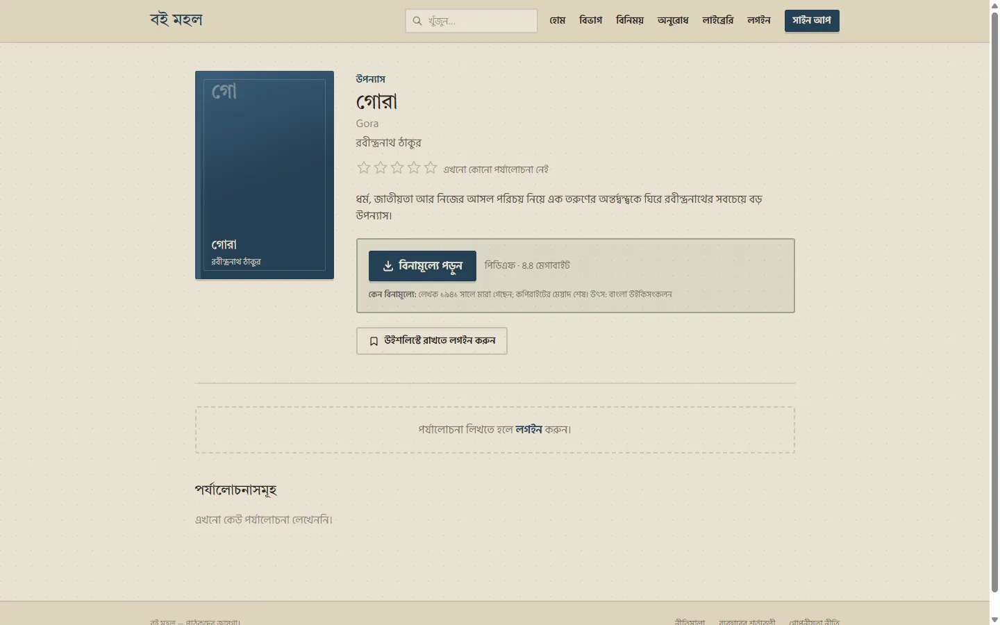
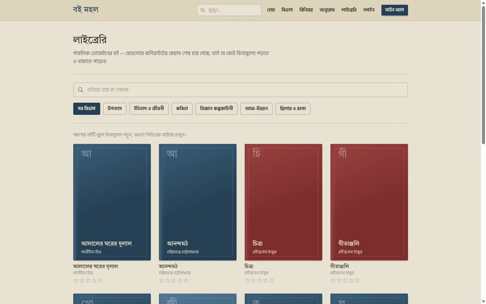
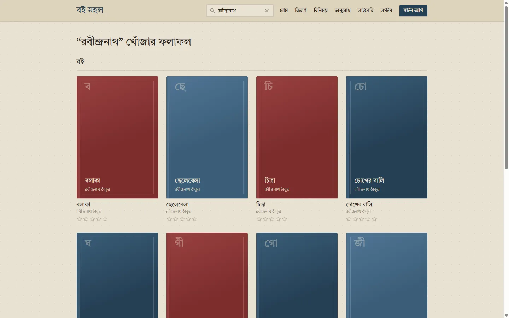
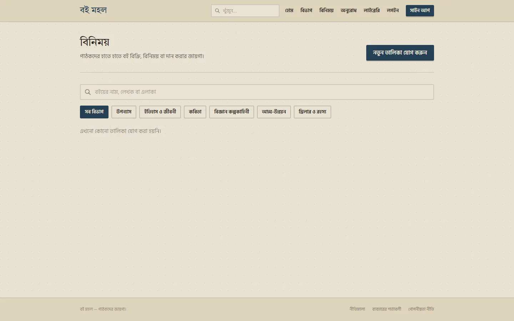
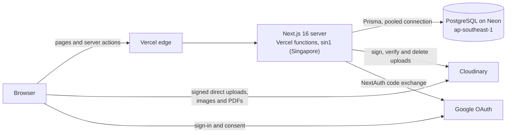

# বই মহল · Boi Mohol

> বাংলা বই খুঁজে নেওয়া, পড়া, পর্যালোচনা লেখা আর হাতে হাতে বই বিনিময়ের একটি ওয়েবসাইট।

Boi Mohol is a Bangla-first web app for readers in Bangladesh. You can find books by category, with a
"start here" pick in each one, keep a shelf, and write reviews. Public-domain classics can be read for
free, and physical books can be passed on through a small marketplace with built-in chat. Every
screen is in Bangla, with Bangla digits and dates in Bangladesh time. Underneath are the details a
Bangla product actually needs:
- search treats differently encoded Bangla text as the same word;
- the library refuses any PDF or reading link that the copyright rule doesn't clear;
- moderation and the privacy policy describe what the code really does.

**Live site:** https://boimohol-delta.vercel.app

---

## Screenshots

| Home | Home on a phone |
|---|---|
|  |  |

| A book with a free PDF | The public-domain library |
|---|---|
|  |  |

| Search results | Marketplace |
|---|---|
|  |  |

All screenshots are of public pages on the live site, taken while signed out.

---

## Features

### Reading
- A catalog organised by category. Each category has an editorial "শুরু করুন এখান থেকে" (start here) pick.
- Book pages with an overall rating plus optional aspect ratings (plot, writing, pacing). Reviews can be edited or deleted by their authors.
- A personal shelf (want to read / reading / finished), a reading streak and a yearly goal with progress.
- A wishlist that flags marketplace listings matching a wished-for book.
- Generated covers for every book. No cover art is copied from elsewhere.

### Marketplace and chat
- Listings to sell, exchange or give away, with condition, price in taka, area and photos.
- Photos upload straight from the browser to Cloudinary with a signed request. The server then checks format and size against Cloudinary's own record.
- One private conversation per listing and buyer. Messages are marked read when opened, and an unread badge in the navbar shows new ones.
- Book requests ("does anyone have this?") that others can answer.
- Reporting of listings, messages and users, plus blocking. A safety notice covers meeting in person.

### Library
- Public-domain books only, as a PDF hosted here or a link to a free copy on Wikisource (any language), Project Gutenberg or the Internet Archive. Links to any other site are refused. Each copy states publicly why it is free (for example, the author's death year and the source).
- The library labels each book as hosted here or external. External links open in a new tab and send no referrer.
- Downloads are counted only in aggregate. Who downloaded what is never recorded, and clicks on external links aren't counted at all.

### Search
- Site-wide search at `/search`, grouping books, listings and requests. There are also search boxes on the category, library, marketplace and requests pages.
- Matching is Bangla-aware (see [the case study](#bangla-aware-search)), and results are ranked: exact, then prefix, then word-prefix, then anywhere.

### Accounts and moderation
- Sign-up through Google only. Existing email/password accounts still log in, and any account can set a password in settings.
- Settings to change the display name, change or set a password, connect or disconnect Google, and delete the account.
- Changing a password signs the account out everywhere else.
- Suspended or deleted accounts are signed out on their next request. This is enforced on the server, not just hidden in the UI.
- A privacy page written to match the code: what is stored, who can see it, what deletion removes and keeps, and what Google sends.

### Admin
- **Books:** add, edit and delete books, plus bulk JSON import with validation and duplicate detection. Import rows can carry links to free copies elsewhere.
- **Library files:** upload a PDF, or add, edit and remove links to free copies elsewhere, each with a required rights note. Books whose public-domain flag the rule no longer supports get a warning.
- **Reports:** a queue where reported content can be removed, or its owner suspended, in one step.
- **Users:** search users, open any user's page to remove listings and delete reviews or requests, suspend or delete the account, and see the moderation history.
- Every moderation step is logged with who did it and when. Admin pages return 404 to everyone else, and the admin role is re-read from the database on every request.

---

## Tech stack

| Layer | Choice |
|---|---|
| Framework | Next.js 16 (App Router, server components, server actions, proxy) · React 19 · TypeScript |
| Styling | Tailwind CSS 3 with a custom palette · Tiro Bangla and Hind Siliguri via `next/font` |
| Database | PostgreSQL on Neon (Singapore): pooled connection at runtime, direct connection for migrations |
| ORM | Prisma 5, with committed migrations applied on every deploy |
| Auth | NextAuth 4 with JWT sessions: Google, plus email/password for accounts that have a password |
| Media | Cloudinary: listing photos as images, library PDFs as raw files |
| Validation | zod, shared between forms and server actions |
| Hosting | Vercel, with functions pinned to Singapore (`sin1`) next to the database |
| Tests | Node's built-in test runner through `tsx` |

## Architecture



- **Rendering:** pages are server components that query the database directly. Every write is a server action that validates its input with zod and re-checks who is calling. A server action is a public endpoint, so the page that rendered the button proves nothing.
- **Sessions:** one helper (`getSessionUserId`) decides what "signed in" means. On every request it re-reads the account to check that it still exists, isn't suspended, has finished sign-up and was issued for the current password.
- **The new-account gate:** `src/proxy.ts` only steers new Google accounts to the username step. The real enforcement is the session helper.
- **Uploads:** the server signs uploads and the browser sends files straight to Cloudinary, so large files never pass through a Vercel function. The server only verifies the result and records it.

```
src/
  app/          routes: pages, layouts, the NextAuth route handler
  actions/      server actions, one file per area (listings, messages, account, admin-moderation, ...)
  components/   UI components
  lib/          auth, session helpers, search, Bangla formatting, rules (with *.test.ts beside them)
  proxy.ts      steers new Google accounts to /welcome
prisma/         schema, migrations, seed
docs/           screenshots
```

---

## Engineering highlights

### Bangla-aware search
**Problem.** The same Bangla word can arrive as different code points. য় can be one character (U+09DF) or য followed by a nukta. Khanda ta can be ৎ or the older ত্ followed by a zero-width joiner. Keyboards and copy-paste also leave invisible joiners and odd spaces behind. A plain `LIKE` match treats all of these as different words.

**What was done.** Every query and every stored row goes through one `normalizeForSearch`:
- NFC normalisation. য় is excluded from Unicode composition, so NFC turns both spellings into য + nukta.
- The old khanda-ta form is mapped to the new one, and zero-width characters are removed.
- NFC runs a second time, because removing a joiner can bring the two halves of a vowel sign together.
- Text is lowercased and whitespace is folded.

Books, listings and requests store a precomputed `searchText`. A migration backfilled it with SQL that mirrors each step. That SQL lowercases with an ICU collation, because Postgres's default `lower()` disagrees with JavaScript on characters such as `Σ` and `İ`. User input is escaped before it reaches `LIKE`, because Prisma's `contains` doesn't escape `%` and `_`.

**Why.** Someone typing on a different keyboard should still find the book. The 21 search tests pin each of these cases down.

### A copyright-safe library
**Problem.** Offering free PDFs, or pointing readers to free copies elsewhere, is only legitimate for books that are actually out of copyright. A wrong flag in the database should not be enough to publish one.

**What was done.** Bangladeshi copyright lasts 60 years after the end of the author's death year. So in year *Y*, a book is public domain only if its author died in *Y* − 61 or earlier. That rule lives in one function, and the server enforces it:
- **Book records:** creating, editing or importing a book cannot mark it public domain if the death year doesn't allow it.
- **Uploads:** only admins can upload. The role is re-read from the database before an upload is signed. After upload, the server checks Cloudinary's own record of the file: the right folder, a `.pdf`, and 50 MB or less. Anything else is deleted.
- **External copies:** a link is accepted only for an eligible book and only on wikisource.org, gutenberg.org or archive.org. The address is parsed, never pattern-matched, so lookalike hosts, embedded credentials, ports and non-web schemes are refused. Links are stored normalised, so the same copy can't be added twice. The same checks run in the admin form, the server actions and the JSON import.
- **Rights note:** every file and every link needs a written note explaining why it is free, and the book page shows it.
- **Downloads:** pages offer a free copy only if the book passes the rule *today*. A stored flag can't outlive the rule, and a book can't be un-marked while a PDF or link is still attached.

There is deliberately no code path for paid files. The PDFs themselves were prepared from Bangla Wikisource exports. Where an edition carried a later publisher's front matter, such as a 1961 copyright notice, that front matter was removed.

**Why.** Each check sits on the server path that a forged request would also have to take.

### Google-only sign-up and safe account linking
**Problem.** Email/password sign-ups never verified their email address. Linking a Google sign-in to an existing account by matching emails would therefore be unsafe in both directions. If the address had been registered by someone else, the Google user would be handed that stranger's account. If the address was really the Google user's, whoever registered it first would keep password access to an account that is now linked to the real owner's Google identity.

**What was done.**
- Google sign-ins are matched only on Google's account ID (`sub`).
- A Google sign-in whose email already belongs to an account is refused, with a Bangla explanation: log in with the password and connect Google from settings, or contact the site if the account isn't yours.
- Connecting happens only from settings, while signed in. A short-lived, HMAC-signed cookie proves the request came from that account, and the Google account's verified email must equal the account's email. A successful connect marks the email verified.
- Disconnecting is refused if the account has no password, so nobody can lock themselves out.
- New sign-ups are Google-only. The server no longer has a password sign-up action at all.
- A new Google account must choose a username before it can use the site.

**Why.** Every new account starts with a verified email address, and an existing account can only be linked by its owner.

### Signing out other sessions after a password change
**Problem.** Sessions are stateless JWTs, so changing a password doesn't end the sessions already handed out. The obvious fix is to compare a `passwordChangedAt` timestamp with the token's issue time (`iat`). Reading NextAuth 4's session route shows why that fails: it re-encodes the token on every session read, which sets a new `iat` each time. It does this even when the session callback has just rejected the token. An old session would therefore get a fresh `iat` on its next request and pass the check.

**What was done.** At sign-in, each token records the password-change time it saw, as a "password stamp" that never changes for the life of the token. The session callback and `getSessionUserId` both refuse a token whose stamp doesn't match the account. The tab where the password was changed signs straight back in with the new password.

**Why.** A browser test checked that a second session is signed out and *stays* out after its token has been refreshed. That is the case the `iat` comparison would have got wrong.

### The open-redirect fix
**Problem.** The login page sends people back to `?callbackUrl=` after signing in. The first version of the guard used string checks: the value must start with `/` and must not start with `//` or `/\`. An adversarial review found a bypass: `/%09/evil.com`. `useSearchParams` decodes `%09` to a tab, so the string passes every check. The URL parser then drops tabs, CR and LF, which leaves `//evil.com`, and the router performs a full navigation to that other site.

**What was done.** The guard now rejects control characters outright, parses the value against a fixed placeholder origin, requires the result to stay on that origin, and returns only the path, query and hash. Pages build these links through one shared helper, so the encoding stays the same everywhere. The weak version was replaced before it was committed.

**Why.** Prefix checks reason about the string. What matters is how the browser will parse it.

### Separating development from production
**Problem.** Seed scripts, browser tests and admin experiments all write data. None of that should ever reach production, and a single shared `.env` would make that one typo away.

**What was done.** Development and production each have their own:
- Neon branch;
- Cloudinary account (cloud);
- Google OAuth client: a localhost one for development, and one for the production domain.

The local `.env` points only at the development side. Production values exist only in Vercel, scoped to the Production environment, so preview deployments receive none of them. That matters because every build runs `prisma migrate deploy`: a preview build holding production credentials would migrate production from an unmerged branch. The test fixtures refuse to run unless the database host is the development branch. The demo account and its published password are skipped when seeding production.

**Why.** Real users' data and the test data should never be able to touch each other.

### A 568 ms server wait that was distance, not N+1
**Problem.** Before the first deployment, a production build ran on a laptop in Dhaka (`npm run build && npm start`) against the Neon database in Singapore. Chrome DevTools showed **568 ms** of "Waiting for server response". A wait that long often points to an N+1 query pattern, so the queries were audited. Each page made 3–6 batched queries, never one per row. So the time wasn't going on the number of queries but on round trips: every one of them went from Dhaka to Singapore and back.

**What was done.** For deployment, the Vercel functions were pinned to Singapore (`sin1`) in `vercel.json` (commit `d6b7a3f`), next to the database. Vercel's default region is Washington, D.C. (`iad1`). That would have sent every query across the Pacific, which is even further than Dhaka. No query code changed.

**How each number was measured.**

| | Where the server ran | Measurement | Result |
|---|---|---|---|
| Before | Production build on a laptop in Dhaka, database in Singapore | Chrome DevTools, "Waiting for server response": from the request being sent to the first byte back, excluding connection setup. Pages didn't stream yet, so the first byte waited for every query. | 568 ms |
| After | Live site, measured from Dhaka on 15 October 2026. Requests go through Vercel's Mumbai edge to the functions in Singapore. | Chrome's network timing, signed out, cache disabled, median of 8 warm loads on each of six public pages: from the request being sent to the **last** byte of the HTML, excluding connection setup | 160–253 ms per page |

The live site's own "Waiting for server response" is 35–78 ms, but that isn't comparable. Since 9 October most pages stream a loading skeleton first, so the first byte arrives before the queries finish. The time to the last byte of the HTML covers all of the server's work. It also includes the network path from Dhaka through Mumbai to Singapore and the transfer of the page itself, none of which the local measurement had to pay.

**Why.** Moving the compute next to the data fixed every page at once, without restructuring a single query.

---

## Known limitations and roadmap

- **Chat polls rather than pushes.** An open conversation checks for new messages every 4 seconds and the unread badge every 20 seconds. That needed no extra infrastructure. Server-sent events or a realtime service would be the next step if traffic grows.
- **No Banglish search.** Search matches the script you type in. A romanised query such as "rabindranath" won't find text stored only in Bangla, unless the book also has an English title. A transliteration index is on the roadmap.
- **No email verification for older password accounts.** Their email is only verified if they connect a Google account with the same address. The site sends no email at all yet, which also means there is no "forgot password" reset.
- **No payments.** The marketplace introduces buyers and sellers. Payment and handover happen in person.
- **Policy pages are drafts.** `/terms`, `/privacy` and `/guidelines` haven't been reviewed by a lawyer, and `/terms` still has a TODO for the governing-law clause.
- **Placeholder app icon.** `public/icons/icon.svg` is a vector placeholder. Real PNG icons (192, 512 and a maskable 512, plus an `apple-touch-icon`) are needed before promoting installation as an app.

---

## Local setup

Requires Node.js 20.9 or later (developed on Node 24) and a PostgreSQL database. A free Neon branch works well.

```bash
cp .env.example .env        # fill in the variables listed below
npm install                 # also runs prisma generate
npx prisma migrate deploy   # applies the committed migrations
npm run seed                # categories, books, starter picks and a demo account
npm run dev                 # http://localhost:3000
```

Environment variables (names only; `.env.example` explains each):

`DATABASE_URL`, `DIRECT_URL`, `NEXTAUTH_SECRET`, `NEXTAUTH_URL`, `CLOUDINARY_CLOUD_NAME`, `CLOUDINARY_API_KEY`,
`CLOUDINARY_API_SECRET`, `NEXT_PUBLIC_CLOUDINARY_CLOUD_NAME`, `GOOGLE_CLIENT_ID`, `GOOGLE_CLIENT_SECRET`

- **Google sign-in.** New accounts can only be created through Google, so local sign-up needs a Google OAuth client (type "Web application") with the authorised redirect URI `http://localhost:3000/api/auth/callback/google`. Without one, the seeded demo account (`demo@boimohol.test` / `demo1234`) still logs in. The demo account and the hint on the login page exist only outside production.
- **Neon connections.** `prisma/schema.prisma` uses the pooled `DATABASE_URL` at runtime and the unpooled `DIRECT_URL` for migrations. Neon's pooler runs PgBouncer in transaction mode, which can't run Prisma Migrate. Neon also suspends idle compute, so the first connection after a quiet spell can be slow. Add `connect_timeout=15&pool_timeout=20` to `DATABASE_URL` and `connect_timeout=15` to `DIRECT_URL`, and retry once if a migration reports `P1001`.
- **Becoming an admin.** The admin pages need the `ADMIN` role. The end of `prisma/seed.ts` has a commented block for promoting your own account.

## Deployment (Vercel)

- **Region.** `vercel.json` pins functions to `sin1` (Singapore), next to the database. Keep the two together; see [the case study above](#a-568-ms-server-wait-that-was-distance-not-n1).
- **Build.** `npm run build` runs `prisma migrate deploy && next build`, so schema changes apply on every deploy. This needs `DIRECT_URL` on the host. `postinstall` runs `prisma generate`, because Vercel caches `node_modules` and the generated client would otherwise drift from the schema. `npm run build:noMigrate` builds without touching any database.
- **Variables.** Set all of the variables above in the Vercel project, scoped to **Production only**. Preview deployments then get no credentials, which keeps a preview build from running migrations against production. To use previews, give Preview its own Neon branch, Cloudinary cloud and Google client.
- **Must differ from development.** Production needs its own `NEXTAUTH_SECRET`, because anyone holding the secret can forge a session. `NEXTAUTH_URL` must be the production origin, or redirects break. The production Google client needs the redirect URI `<NEXTAUTH_URL>/api/auth/callback/google`.
- **Never public.** Anything prefixed `NEXT_PUBLIC_` is compiled into the JavaScript every visitor downloads. Only `NEXT_PUBLIC_CLOUDINARY_CLOUD_NAME` is safe to expose, since a cloud name already appears in every image URL. Never add the prefix to `CLOUDINARY_API_SECRET`, `CLOUDINARY_API_KEY`, `NEXTAUTH_SECRET`, `GOOGLE_CLIENT_SECRET`, `DATABASE_URL` or `DIRECT_URL`.
- **Seeding production.** `npm run seed` skips the demo account when `NODE_ENV=production`.
- **Third parties.** `/privacy` names Vercel, Neon, Cloudinary and Google as the only third parties. Adding analytics, ads or payments means updating that page in the same change.

---

## Testing

**Unit tests.** `npm test` runs 104 tests with Node's built-in test runner, through `tsx`. They cover the pure modules where the rules live:

| Area | Tests |
|---|---|
| Search: normalisation (encodings, khanda ta, zero-width characters, spacing), `LIKE` escaping, ranking | 21 |
| Bangla numbers, prices and dates in Bangladesh time, with no Latin digits | 18 |
| Wishlist ↔ listing matching | 15 |
| Account rules: sign-up validation, the password stamp, the last-admin rule, Google names and emails | 9 |
| Book import rows (including links to free copies) and the admin book form | 13 |
| Duplicate detection and book IDs | 8 |
| The public-domain rule, including the year boundary | 6 |
| Links to free copies elsewhere: the three trusted sites, lookalikes, credentials, schemes, normalisation | 6 |
| Grapheme-safe text snippets (never cutting a Bangla conjunct) | 4 |
| The signed connect-Google cookie (forgery, expiry, junk) | 4 |

`npm run lint` and `npm run build`, which includes the TypeScript check, run before every merge.

**Browser verification.** Every feature was also checked end to end in a real Chrome, driven through the Chrome DevTools Protocol, against the development database:
- QA accounts are seeded for each run and deleted afterwards.
- Each step is checked against both the page and the database.
- Server-side authorization is tested by capturing a real server-action request and replaying it with other arguments or as another user. The test passes only if the server refuses on its own, not just because the UI hides the button.
- Every page is checked for sideways overflow at phone and desktop widths, with screenshots.
- Google sign-in was tested with a real Google account in a visible browser: sign-up with the username step, returning sign-in, the refused-email case, connect and disconnect, and a suspended account being refused.

These scripts were run during development and aren't part of the repository.

---

## Copyright notes

- `BookFile.rightsVerified` is set only by the upload path, after every check has passed. There is no code path for paid files.
- Book covers are always generated. No real cover art is copied or hotlinked.
- Before adding a title or a reading link to the library, check the author's death year against the rule above. Be especially careful with authors who died within about the last 60 years.
